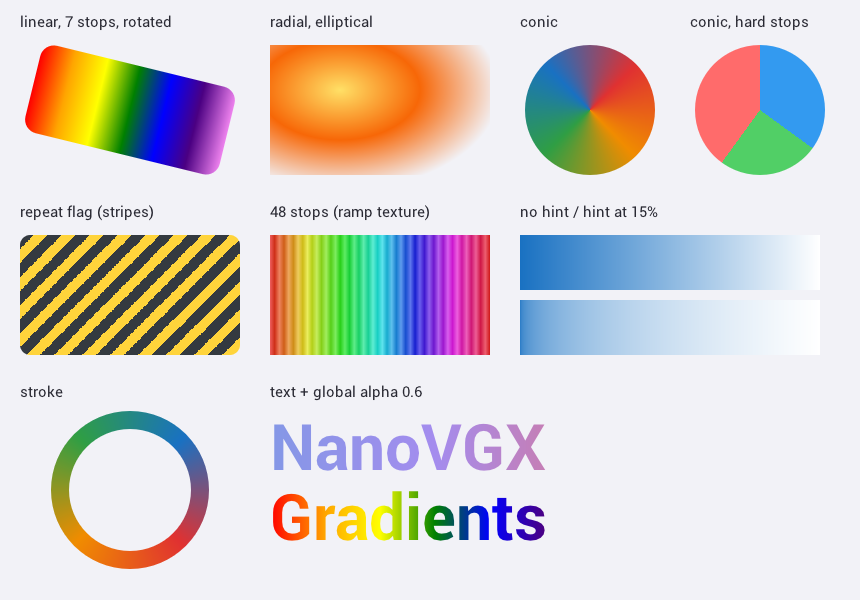

# NanoVGX

NanoVGX is a fork of [NanoVG](https://github.com/memononen/nanovg) by Mikko Mononen. It adds
**multi-stop gradients** (linear, elliptical radial and conic) and a **grayscale mode** to
NanoVG's OpenGL backends, and fixes several memory leaks in failure paths.

This is an **altered version** of NanoVG, as required by the zlib license. See
[LICENSE.txt](LICENSE.txt) for the original license, which still applies.



## Changes from NanoVG

All of NanoVG's existing API is unchanged. Existing code compiles as before.

### Multi-stop gradients

- New gradient paints with any number of colour stops:
  - `nvgLinearGradientStops` for linear gradients.
  - `nvgRadialGradientStops` for radial gradients, which can be elliptical.
  - `nvgConicGradient` for conic (sweep) gradients.
- Gradients are evaluated per pixel in the fragment shader, so they stay sharp at any size.
  Hard colour stops stay sharp too.
- Optional CSS-style colour hints (the position where two colours mix 50/50), and a repeat flag
  for `repeating-*-gradient` style patterns.
- Colours are interpolated in premultiplied sRGB, which is what CSS does, so fading to
  transparent doesn't produce dark fringes.
- The new paints work everywhere a NanoVG paint works:
  - fills (`nvgFillPaint`)
  - strokes (`nvgStrokePaint`)
  - text
  - transforms (rotating or scaling the canvas moves the gradient with the shape)
  - `nvgGlobalAlpha`
- Gradients with more stops than the shader handles (`NVG_MAX_GRADIENT_STOPS`, 16 by default)
  are baked into a cached colour lookup texture (1024 px wide). The gradient position is still
  computed per pixel.

### Grayscale mode

`nvglSetGrayscale(ctx, enabled)` in the GL backend turns all drawing grayscale, images
included, by converting each final pixel colour to luminance in the shader. When it's off, the
only cost is one uniform check per pixel. It takes effect from the next frame.

### Leak fixes

These leaks are all in failure paths:

- `fontstash.h`: four `x = realloc(x, ...)` calls lost the old block (and then dereferenced
  NULL) when `realloc` failed.
- `fonsAddFontMem`: font data handed over with `freeData=1` (as `nvgCreateFont` does) leaked if
  allocating the font slot failed.
- `glnvg__createShader`: the GL program and shader objects leaked when compiling or linking
  failed.
- `nvgCreateInternal`: the GL backend leaked if the context itself couldn't be allocated. It's
  now freed the same way as on every other failure.
- `nvg__allocTextAtlas`: if creating a new font atlas texture failed, it switched to the missing
  atlas anyway, and `nvgEndFrame` then never cleaned up the atlases again.

Each fix is marked with a `NanoVGX` comment in the source. The two well-known upstream leaks
were already fixed in the NanoVG version this fork is based on: font images leaking in
`nvgEndFrame` (PR #626) and buffers not freed in `glnvg__renderDelete` (PR #115).

## Using it

NanoVGX is a drop-in replacement for NanoVG. You can include either the new header names or
the old ones:

```c
#include "nanovgx.h"          // or "nanovg.h"
#define NANOVG_GLES3_IMPLEMENTATION
#include "nanovgx_gl.h"       // or "nanovg_gl.h"
```

Build `src/nanovgx.c` along with your code. With CMake, add the folder as a subdirectory and
link the `nanovgx` target:

```cmake
add_subdirectory(path/to/nanovgx)
target_link_libraries(myapp PRIVATE nanovgx)
```

## API

```c
typedef struct NVGcolorStop {
	float offset;    // position along the gradient, normally 0..1
	NVGcolor color;
	float hint;      // optional colour hint between this stop and the next; 0 = none
} NVGcolorStop;

enum NVGgradientFlags {
	NVG_GRADIENT_REPEAT = 1<<0,   // repeat the span from the first to the last stop
};

// Offset 0 at (sx,sy), offset 1 at (ex,ey).
NVGpaint nvgLinearGradientStops(NVGcontext* ctx, float sx, float sy, float ex, float ey,
                                const NVGcolorStop* stops, int nstops, int flags);

// Offset 0 at the centre, offset 1 on the ellipse with radii (rx,ry).
NVGpaint nvgRadialGradientStops(NVGcontext* ctx, float cx, float cy, float rx, float ry,
                                const NVGcolorStop* stops, int nstops, int flags);

// Offset 0 at 'angle' (radians, 0 = +x axis); offsets go clockwise; 1 = one full turn.
NVGpaint nvgConicGradient(NVGcontext* ctx, float cx, float cy, float angle,
                          const NVGcolorStop* stops, int nstops, int flags);
```

Stops must be sorted by offset. If two stops share an offset, the colour changes sharply there
(a hard stop).

From `nanovgx_gl.h`:

```c
// Draw everything in grayscale (luminance), images included. Takes effect from the next frame.
void nvglSetGrayscale(NVGcontext* ctx, int enabled);
```

Example:

```c
NVGcolorStop stops[3] = {
	{ 0.0f, nvgRGB(59, 91, 219) },
	{ 0.5f, nvgRGB(112, 72, 232) },
	{ 1.0f, nvgRGB(194, 37, 92) },
};
nvgBeginPath(vg);
nvgRoundedRect(vg, 10, 10, 300, 80, 12);
nvgFillPaint(vg, nvgLinearGradientStops(vg, 10, 0, 310, 0, stops, 3, 0));
nvgFill(vg);
```

### Converting from CSS

| CSS | NanoVGX |
|---|---|
| `linear-gradient(...)` | `nvgLinearGradientStops` from the start point to the end point of the gradient line. |
| `radial-gradient(ellipse rx ry at cx cy, ...)` | `nvgRadialGradientStops(ctx, cx, cy, rx, ry, ...)` |
| `conic-gradient(from A at cx cy, ...)` | `nvgConicGradient(ctx, cx, cy, nvgDegToRad(A) - NVG_PI/2, ...)` |
| `repeating-*-gradient(...)` | Same function, with `NVG_GRADIENT_REPEAT`. |
| Colour hint `red, 30%, blue` | `stops[i].hint = 0.3f` on the `red` stop. |

## Limits

- **Text:** text supports up to `NVG_MAX_GRADIENT_STOPS` stops. Text drawn with a gradient
  that has more stops is drawn in a single colour.
- **Interpolation modes:** only the CSS default (premultiplied sRGB) is supported. CSS
  `in oklab` / `in hsl` interpolation isn't.
- **Uniform memory:** each stop costs two vec4 fragment uniforms, so the shader needs
  `12 + 2*NVG_MAX_GRADIENT_STOPS` uniform vectors (44 by default). Desktop GL and GLES3 have
  plenty. On old GLES2 hardware with very few uniforms, compile with a smaller value, for
  example `-DNVG_MAX_GRADIENT_STOPS=8`. Gradients with more stops than that use the lookup
  texture automatically.
- **Lookup texture cache:** up to 64 lookup textures are cached. One that hasn't been drawn
  for 60 frames is freed.

## Example

`example/example_gradients.c` uses OpenGL ES 3 through GLFW:

```sh
cmake -S . -B build && cmake --build build
./build/example_gradients                # animated window
./build/example_gradients --png out.png  # render one frame to a PNG and exit
```

## Testing

The gradient example was checked on the GLES3 and desktop GL3 backends. The GL2 and GLES2
backends compile from the same shader source but haven't been run.

## Credits

NanoVG is by Mikko Mononen (zlib license). The Roboto fonts in `example/` are under the SIL
Open Font License ([LICENSE_OFL.txt](example/LICENSE_OFL.txt)).
